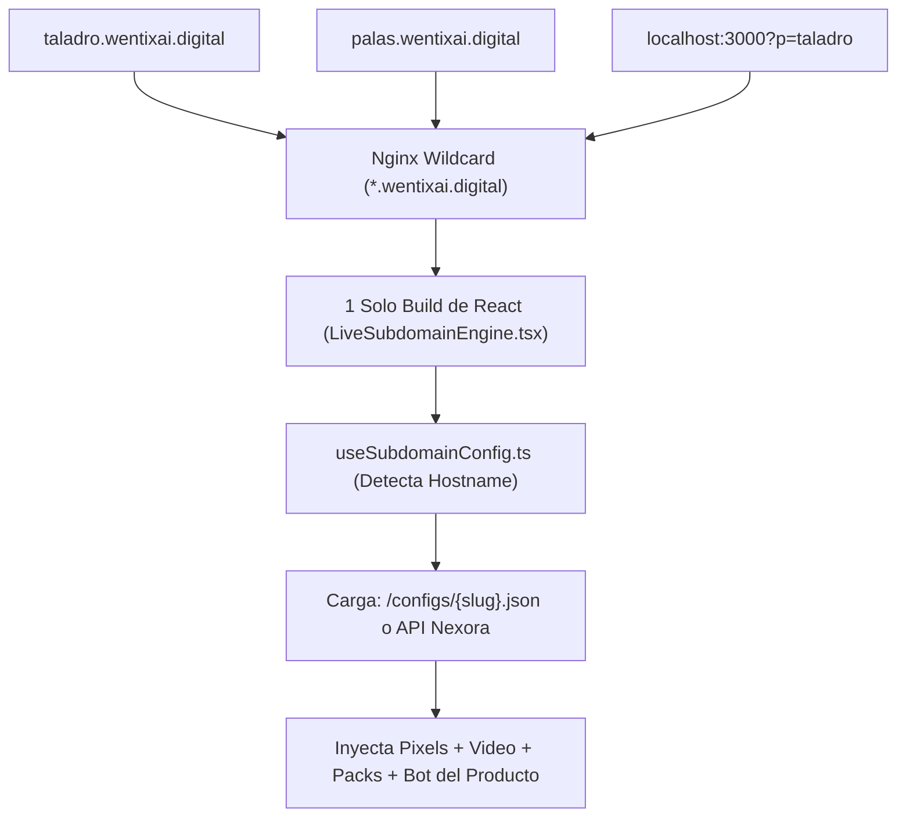

# 🚀 GUÍA MAESTRA: WENTIX LIVE-LANDING TEMPLATE PARA NEXORA ERP
## (Incluye Motor Automático de Subdominios Wildcard)

> **Ubicación del Template**: `F:\Open Code\Wentix AI Live Shop\nexora-live-template`  
> **Destino en Producción**: VPS Contabo `161.97.160.76` (`/opt/nexora/landings`)  
> **Arquitectura**: Multi-tenant por Subdominios (`taladro.wentixai.digital`, `pulidor.wentixai.digital`)  
> **Compatibilidad**: Next.js 14 / React + Vite / Nginx Wildcard / Nexora SQLite / Dropi Chile

---

## 1. 🌐 ¿Cómo Funciona el Motor de Subdominios Automático?

El template **NO requiere compilar una página nueva por cada producto**. Funciona con un motor dinámico multi-tenant:



1. El usuario entra a `taladro.wentixai.digital`.
2. El hook [`useSubdomainConfig.ts`](./useSubdomainConfig.ts) extrae el slug: `"taladro"`.
3. Carga la configuración del producto desde `https://nexora.wentixai.cyou/api/landings/taladro` o del archivo local `/configs/taladro.json`.
4. El componente [`LiveSubdomainEngine.tsx`](./LiveSubdomainEngine.tsx) inyecta:
   * Los Pixels de Meta y TikTok específicos de ese producto.
   * El video vertical 9:16.
   * El bot con la FAQ exclusiva del producto.
   * El formulario contraentrega con los packs de 1, 2 y 3 unidades.

---

## 2. 📁 Inventario Completo de Archivos en `nexora-live-template/`

| Archivo | Qué hace |
| :--- | :--- |
| 🌐 **`useSubdomainConfig.ts`** | **Motor de resolución de subdominios**. Extrae el slug de la URL en vivo o por query param (`?p=slug` para pruebas locales). |
| 🎬 **`LiveSubdomainEngine.tsx`** | **Componente orquestador de la landing**. Conecta el subdominio con el video, likes, chat, bot IA y checkout. |
| ⚙️ **`wildcard-nginx.conf`** | **Configuración oficial de Nginx** para tu VPS con soporte Wildcard `*.wentixai.digital` y proxy a Nexora. |
| 📋 **`template.config.json`** | **Molde de configuración de producto**. Título, precios CLP, packs 1/2/3, video URL, FAQ y Pixels. |
| 🛍️ **`QuickCheckoutChileModal.tsx`** | Cajón de compra contraentrega con packs de ahorro, selector de comunas y envío directo a Nexora. |
| 🇨🇱 **`comunasChile.ts`** | Catálogo oficial de comunas de Chile para evitar rechazos en Blue Express / Starken. |
| 🔌 **`nexoraClient.ts`** | Conector HTTP con la API de Nexora (`https://nexora.wentixai.cyou/api/orders`). |
| 📊 **`pixelTracker.ts`** | Tracker de Meta Pixel & TikTok Pixel (`ViewContent`, `InitiateCheckout`, `Purchase`). |
| 🤖 **`AiBotHandler.ts`** | Motor del bot monoproducto (FAQ local instantáneo + soporte Gemini / Groq Free). |

---

## 3. ⚡ Paso a Paso para Desplegar en Nexora

### Paso 1: Copiar la carpeta a Nexora
```powershell
Copy-Item -Path "F:\Open Code\Wentix AI Live Shop\nexora-live-template" -Destination "F:\Open Code\Wentix AI MarketPlace\meibo-mvp\templates\live-landing" -Recurse
```

### Paso 2: Configurar el DNS Wildcard
En tu panel de DNS (Cloudflare / Namecheap / GoDaddy):
* **Tipo**: `A`
* **Nombre**: `*`
* **Valor**: `161.97.160.76` (IP de tu VPS)

### Paso 3: Activar Nginx en el VPS
Copia el archivo [`wildcard-nginx.conf`](./wildcard-nginx.conf) a `/etc/nginx/sites-available/live-landings` y activa el enlace:
```bash
ln -s /etc/nginx/sites-available/live-landings /etc/nginx/sites-enabled/
nginx -t && systemctl reload nginx
```

### Paso 4: Lanzar un Nuevo Producto en 60 Segundos
Para crear una landing para un producto nuevo (ejemplo: `pulidor`):
1. Copias `template.config.json` a `/opt/nexora/landings/dist/configs/pulidor.json`.
2. Le colocas su video, sus precios y sus píxeles.
3. ¡Listo! Al abrir en el navegador `pulidor.wentixai.digital` ya está en vivo y vendiendo.

---

## 4. 🤖 Comando para Hermes Agent (Control vía MCP)

Para crear subdominios automáticamente desde la PWA de Hermes:
```yaml
# En /root/.hermes/config.yaml o server/mcp.mjs en Nexora:
tool: nexora_create_live_landing
params:
  slug: "taladro"
  dropi_id: 33369
  price: 19990
  video_url: "https://cdn.wentixai.digital/videos/taladro.mp4"
```
Hermes escribe el archivo `/opt/nexora/landings/dist/configs/taladro.json` y el subdominio queda activo al segundo.
